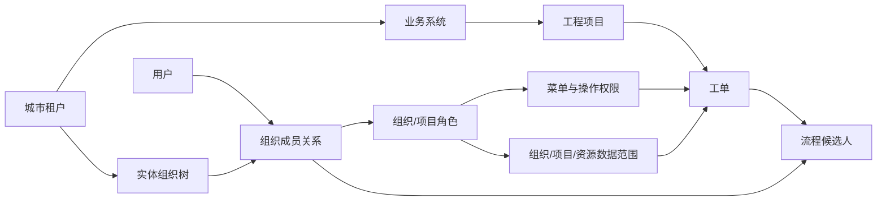
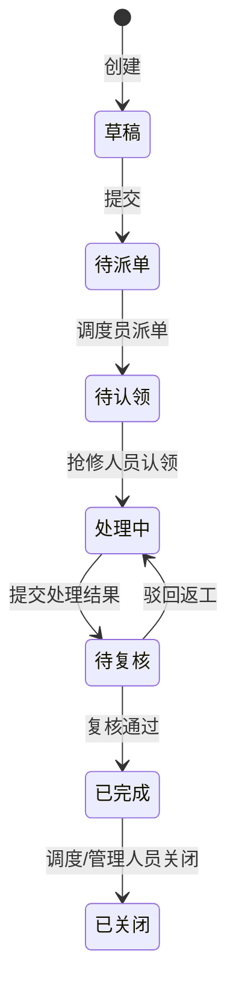

# 权限系统与工单中心核心能力及三大演示场景

版本：V0.1（I26 权限模型简化已完成）  
用途：产品介绍、内部汇报、客户演示和录屏脚本

## 一、平台解决什么问题

本平台面向智慧城市生命线的多租户、多业务系统和多工程项目场景，把“谁能进入哪个城市和系统、能操作什么、能看到哪些数据、可以处理哪些工单”统一到一套权限与流程模型中。

平台的核心价值不是单独提供用户管理或工单列表，而是建立以下闭环：

### 1. SaaS 与业务系统隔离

- 平台 `root` 统一管理多个城市租户，并选择进入目标城市。
- 每个城市独立维护用户、组织、角色、项目和工单。
- 城市下可以开通供水、排水、燃气、供热、道路等业务系统。
- 同一用户可以只进入一个系统，也可以同时进入多个业务系统。
- 工单、流程实例和任务均携带租户、系统、项目上下文，避免跨边界串单。

### 2. 组织、角色与数据权限

- 实体组织采用树形结构，支持甲方、监管方、监理方、施工方和软件平台方。
- 用户可以加入多个组织，并在不同组织中分别拥有角色。
- 角色控制页面、接口和业务操作权限。
- 数据范围支持 `ALL`、`ORG`、`ORG_AND_CHILD`、`SELF`、`CUSTOM`。
- 用户最终权限由“当前租户 + 系统入口 + 项目成员 + 组织角色 + 数据范围”共同决定。
- 系统数据权限继续支持数据空间、资源策略、字段隐藏/脱敏、GIS 空间范围和导出控制。

### 3. 工单与流程闭环

- 支持工单创建、提交、派单、认领、处理、复核、关闭。
- 派单与组织角色、系统入口和项目成员联动，只有合格人员成为任务候选人。
- 支持附件、评论、转派、催办、通知、SLA 和批量处理。
- 页面按钮只是操作提示，服务端会再次执行功能权限和数据权限校验。
- 工单时间线保留每次状态变化、操作人和处理说明。

## 二、演示账号

以下均为本地演示数据，不用于生产环境。

| 账号 | 密码 | 演示身份 | 主要用途 |
|---|---|---|---|
| `root` | `Root@123456` | 平台超级管理员 | 选择和进入城市租户 |
| `admin` | `Demo@123456` | 当前城市租户管理员 | 查看组织、用户、角色和权限结构 |
| `water_manager` | `Demo@123456` | 供水 GIS 系统管理员 | 验证只能进入获授权业务系统 |
| `gas_manager` | `Demo@123456` | 燃气 GIS 系统管理员 | 验证供水/燃气系统隔离 |
| `wangwu` | `Demo@123456` | 甲方调度管理员 | 创建、提交、派发和关闭工单 |
| `lisi` | `Demo@123456` | 抢修3组现场施工人员 | 认领并处理工单 |
| `regulator` | `Demo@123456` | 监管复核人员 | 复核工单处理结果 |

建议演示前清理浏览器登录状态，或者为不同账号使用独立的无痕窗口。切换用户权限后应重新登录，以刷新会话中的组织、系统和项目上下文。

## 三、三个最核心演示场景

## 场景一：一个平台管理多个城市，但业务系统彼此隔离

### 演示目标

证明平台能够同时隔离“城市租户”和“城市内业务系统”，不同身份登录后进入不同导航路径。

### 建议时长

2–3 分钟。

### 操作步骤

1. 使用 `root / Root@123456` 登录。
2. 展示城市租户选择页面，说明每个城市拥有独立的组织、用户、项目和工单数据。
3. 进入当前演示城市，展示城市租户的应用导航。
4. 退出并使用 `water_manager / Demo@123456` 登录。
5. 展示账号直接进入供水 GIS 驾驶舱，只能看到供水系统授权范围。
6. 尝试访问燃气或其他未授权业务入口，验证页面拒绝访问。
7. 使用 `gas_manager / Demo@123456` 登录，展示直接进入燃气 GIS 驾驶舱。
8. 尝试访问供水驾驶舱，验证返回无权限。

### 应重点讲解

- 用户登录只需要用户名和密码，不需要输入租户编码。
- 平台根据全局登录名解析租户和身份。
- 业务驾驶舱不是所有用户都能看到；系统入口是第一层数据边界。
- 后续接入真实 GIS、水力模型或数据中心时，可以沿用同一系统入口和资源授权上下文。

### 演示成功标准

- `root` 可以选择城市。
- 供水管理员只能进入供水业务方向。
- 燃气管理员只能进入燃气业务方向。
- 直接输入未授权页面地址仍然被拒绝。

## 场景二：同一用户加入多个组织，但权限随组织和项目变化

### 演示目标

证明“加入组织”不等于自动获得业务权限，组织内角色、系统入口和项目成员关系共同决定最终权限。

### 建议时长

3–4 分钟。

### 操作步骤

1. 使用 `admin / Demo@123456` 登录。
2. 打开“组织管理”，展示左侧完整组织树和右侧组织详情。
3. 定位施工方组织树下的“供水施工项目组”和“抢修3组”。
4. 打开“用户管理”，进入 `lisi` 详情。
5. 展示 `lisi` 同时属于“供水施工项目组”和“抢修3组”。
6. 展示 `lisi` 在“抢修3组”下的组织内角色为 `REPAIRER`。
7. 打开“角色管理”，进入抢修人员角色详情，展示 `workorder:view`、`workorder:claim`、`workorder:handle` 等权限及 `SELF` 数据范围。
8. 说明 `lisi` 已获得供水系统入口，并以“抢修3组”成员身份加入供水管网更新改造项目。
9. 对比 `gas_manager`：虽然是业务管理员，但没有供水项目成员和供水工单操作权限，因此不能接收供水抢修任务。

### 应重点讲解

- 用户与角色不是全局直接绑定，而是通过“用户—组织成员关系—角色”绑定。
- 同一个人在 A 组织可以是管理员，在 B 组织可以是普通处理人员。
- 项目是业务数据权限载体，实体组织仍保持真实组织结构。
- 工单候选人必须同时满足目标组织角色、系统入口、项目成员和处理权限。

### 当前页面边界

当前页面可以完成组织、用户、组织角色和角色数据范围配置。系统入口、项目参与组织和项目成员的服务端能力已经存在，其可视化编辑页面在 I26 简化完成后顺延为下一轮 P1；当前场景以查看已配置结果为主。

### 演示成功标准

- 组织树清楚展示上下级关系。
- 用户详情清楚展示每个组织下不同的角色。
- 角色详情能说明功能权限与数据范围的区别。
- 能解释为什么“只是组织成员”仍可能无法接单。

## 场景三：供水工单从甲方派发到抢修3组并完成闭环

### 演示目标

证明权限配置可以真正驱动工单流转，而不只是控制菜单显示。

### 建议时长

5–7 分钟。

### 前置条件

- `lisi` 在抢修3组绑定 `REPAIRER` 角色。
- `lisi` 已获得供水系统入口，并以抢修3组成员身份加入供水管网更新改造项目。
- 演示过程中各账号重新登录，确保会话上下文最新。

### 操作步骤

#### A. 创建与派单

1. 使用 `wangwu / Demo@123456` 登录。
2. 进入工单中心，新建一张“城北 DMA 管线压力异常”工单。
3. 展示新建后状态为“草稿”，说明创建和提交是两个独立动作。
4. 点击“提交”，状态进入“待派单”，并生成独立派单任务。
5. 打开工单详情，目标组织选择“抢修3组”，填写派单说明并确认。
6. 状态进入“待认领”。

#### B. 抢修人员认领与处理

1. 退出并使用 `lisi / Demo@123456` 重新登录。
2. 进入“我的任务”，看到刚才派往抢修3组的任务。
3. 点击认领，工单状态进入“处理中”。
4. 上传一份演示附件或填写处理说明。
5. 提交处理结果，并将复核组织选择为监管组织。
6. 工单状态进入“待复核”。

#### C. 监管复核与关闭

1. 使用 `regulator / Demo@123456` 登录。
2. 在“我的任务”中打开待复核工单。
3. 先讲解“驳回返工”会回到处理中；正式演示选择“复核通过”。
4. 工单状态进入“已完成”。
5. 使用 `wangwu` 再次登录，打开工单并执行关闭。
6. 展示完整时间线：创建、提交、派单、认领、提交结果、复核通过、关闭。

### 负向验证

在完整流程后补充一个简短反例：

1. 使用 `gas_manager` 登录。
2. 说明该账号不属于供水项目，也不是抢修3组成员。
3. 验证其看不到这张供水工单，无法通过地址或接口认领。

### 演示成功标准

- 工单每一步只对正确角色显示操作入口。
- `lisi` 能看到并认领抢修3组任务。
- 非候选人不能认领。
- 复核通过后才允许关闭。
- 时间线完整记录所有关键动作。
- 第二张工单可以独立派发，证明流程不限制只能派发一张。

## 四、建议的整段录屏结构

| 段落 | 内容 | 建议时长 |
|---|---|---:|
| 开场 | 一句话说明平台解决的权限和工单协同问题 | 30 秒 |
| 场景一 | 城市租户与业务系统隔离 | 2–3 分钟 |
| 场景二 | 组织、用户、角色和数据范围 | 3–4 分钟 |
| 场景三 | 工单完整闭环及负向验证 | 5–7 分钟 |
| 收尾 | 展示时间线、审计和下一迭代 | 1 分钟 |

推荐成片总时长控制在 12–15 分钟。录屏中每完成一个动作，都应展示一次状态或可见范围变化，避免只连续点击页面而没有解释权限判断结果。

## 五、当前产品边界与下一迭代

当前版本已经具备可运行的 SaaS、IAM、项目权限、资源权限和工单流程后端闭环，但以下管理能力尚未完全页面化：

- 用户系统入口授权；
- 项目参与组织配置；
- 项目成员及项目角色配置；
- 派单目标组织的候选人数预检查；
- 零候选组织的前端禁用和结构化错误提示；
- 派单调度候选人按项目角色统一解析。

上述内容已经确定为 I26 P1，详细范围见 `docs/iterations/I26.md`。I26 完成后，场景二可以从“展示配置结果”升级为“现场完成配置”，三个场景将形成完全不依赖 `/docs` 或数据库操作的纯页面演示。
