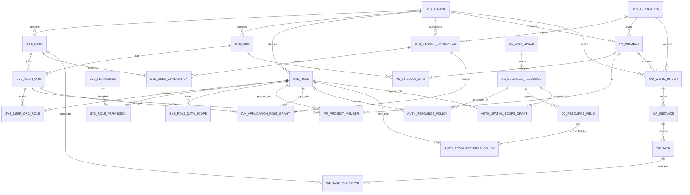

# 权限相关表结构设计说明

版本：I26 / Alembic Head `0019_i26_remove_positions`  
更新时间：2026-10-26  
适用范围：城市生命线 SaaS 权限系统、项目权限、数据资源权限、GIS 权限及工单流程权限

## 1. 设计结论

当前权限体系不是单表 RBAC，而是以下六层授权上下文的组合：

```text
租户隔离
  ∩ 当前组织下的角色与功能权限
  ∩ 租户已开通系统 + 用户系统入口
  ∩ 项目参与组织 + 项目成员角色
  ∩ 数据资源 ALLOW/DENY + 字段策略 + 空间范围
  ∩ 当前流程任务候选人/处理人资格
```

I26 已取消岗位维度。人员授权的唯一主链为：

```text
sys_user
  → sys_user_org
  → sys_user_org_role
  → sys_role
  → sys_role_permission
  → sys_permission
  → sys_role_data_scope
```

`sys_position`、`sys_user_org_position`、`system:position:*` 和 `ORG_POSITION` 已从当前模型删除。历史迁移中仍可看到旧表定义，仅用于数据库版本演进，不代表当前运行模型。

所有使用 `IdTimestampMixin` 的表默认包含：

| 字段 | 类型 | 说明 |
| --- | --- | --- |
| `id` | INTEGER | 自增主键 |
| `created_at` | DATETIME | 创建时间 |
| `updated_at` | DATETIME | 最后更新时间 |

## 2. 总体关系图



## 3. 核心 IAM 表

### 3.1 `sys_tenant`：城市租户

| 关键字段 | 类型 | 约束/含义 |
| --- | --- | --- |
| `tenant_code` | VARCHAR(80) | 全局唯一租户编码 |
| `tenant_name` | VARCHAR(160) | 城市或客户名称 |
| `is_active` | BOOLEAN | 租户启停状态 |

租户是业务账号、组织、角色、系统订阅、项目和数据资源的最高隔离边界。

### 3.2 `sys_user`：租户用户

| 关键字段 | 类型 | 约束/含义 |
| --- | --- | --- |
| `tenant_id` | FK | → `sys_tenant.id` |
| `username` | VARCHAR(80) | 租户内业务账号；`(tenant_id, username)` 唯一 |
| `login_name` | VARCHAR(120) | 统一登录名，全局唯一 |
| `display_name` | VARCHAR(120) | 姓名/显示名 |
| `password_hash` | VARCHAR(255) | 密码哈希，不保存明文 |
| `phone` | VARCHAR(40) | 可选手机号 |
| `is_active` | BOOLEAN | 用户启停状态 |

用户本身不保存 `org_id`、`role_id`。一个用户通过 `sys_user_org` 加入多个组织。

### 3.3 `sys_org`：实体组织树

| 关键字段 | 类型 | 约束/含义 |
| --- | --- | --- |
| `tenant_id` | FK | → `sys_tenant.id` |
| `parent_id` | FK | → `sys_org.id`，根组织为空 |
| `org_code` | VARCHAR(80) | 租户内唯一组织编码 |
| `org_name` | VARCHAR(160) | 组织名称 |
| `org_type` | VARCHAR(40) | OWNER、REGULATOR、CONTRACTOR 等 |
| `org_path` | VARCHAR(500) | 物化路径，用于下级组织查询 |
| `sort_no` | INTEGER | 同级排序 |
| `is_active` | BOOLEAN | 组织启停状态 |

组织仅表达真实甲方、监管、监理、施工方、软件供应商及其部门，不用组织节点模拟项目。

### 3.4 `sys_user_org`：用户组织成员关系

| 关键字段 | 类型 | 约束/含义 |
| --- | --- | --- |
| `user_id` | FK | → `sys_user.id` |
| `org_id` | FK | → `sys_org.id` |
| `is_primary` | BOOLEAN | 是否主组织 |
| `is_active` | BOOLEAN | 成员关系是否有效 |
| `joined_at` | DATETIME | 加入时间 |

唯一约束：`(user_id, org_id)`。角色、系统角色和项目成员都基于这条成员关系挂接，从而保证同一个人在不同组织可以承担不同职责。

### 3.5 `sys_role`：角色字典

| 关键字段 | 类型 | 约束/含义 |
| --- | --- | --- |
| `tenant_id` | FK | → `sys_tenant.id` |
| `role_code` | VARCHAR(80) | 租户内唯一角色编码 |
| `role_name` | VARCHAR(120) | 角色名称 |
| `role_type` | VARCHAR(40) | SYSTEM、BUSINESS 等分类 |
| `is_active` | BOOLEAN | 角色启停状态 |

角色统一表达人员职责，也是 Permission、DataScope、应用角色、项目角色、资源策略、字段权限和空间权限的主要主体。

### 3.6 `sys_user_org_role`：组织内角色

| 关键字段 | 类型 | 约束/含义 |
| --- | --- | --- |
| `user_org_id` | FK | → `sys_user_org.id` |
| `role_id` | FK | → `sys_role.id` |

唯一约束：`(user_org_id, role_id)`。这是当前人员授权主链中替代原岗位关系的核心表。

### 3.7 `sys_permission`：功能权限字典

| 关键字段 | 类型 | 约束/含义 |
| --- | --- | --- |
| `permission_code` | VARCHAR(120) | 全局唯一稳定编码，例如 `workorder:dispatch` |
| `permission_name` | VARCHAR(160) | 权限名称 |
| `resource_type` | VARCHAR(40) | SYSTEM、PROJECT、WORKORDER、DATA、GIS |
| `description` | TEXT | 权限说明 |

权限字典是共享稳定目录，不按租户重复创建；租户角色通过关联表选择使用哪些权限。

### 3.8 `sys_role_permission`：角色功能授权

| 关键字段 | 类型 | 约束/含义 |
| --- | --- | --- |
| `role_id` | FK | → `sys_role.id` |
| `permission_id` | FK | → `sys_permission.id` |

唯一约束：`(role_id, permission_id)`。决定角色“能做什么”。

### 3.9 `sys_role_data_scope`：角色数据范围

| 关键字段 | 类型 | 约束/含义 |
| --- | --- | --- |
| `role_id` | FK | → `sys_role.id` |
| `permission_code` | VARCHAR(120) | 对应功能权限编码 |
| `scope_type` | VARCHAR(40) | `ALL / ORG / ORG_AND_CHILD / SELF / CUSTOM` |
| `scope_config` | JSON | CUSTOM 时保存 `org_ids` 等受控配置 |

唯一约束：`(role_id, permission_code)`。功能权限和数据范围必须同时配置，分别回答“能做什么”和“能处理哪些数据”。

## 4. 登录会话与审计表

### 4.1 平台 Root

| 表 | 关键字段 | 用途 |
| --- | --- | --- |
| `sys_platform_user` | `username`、`password_hash`、`is_active` | 平台级 Root 身份，不继承租户权限 |
| `sys_platform_session` | `platform_user_id`、`token_hash`、`expires_at`、`revoked_at` | Root 会话与城市选择入口 |

### 4.2 `sys_auth_session`：租户业务会话

| 关键字段 | 类型 | 含义 |
| --- | --- | --- |
| `tenant_id` | FK | 当前租户 |
| `user_id` | FK | 当前用户 |
| `active_org_id` | FK | 当前生效组织，决定组织角色和 DataScope |
| `active_application_id` | FK | 当前系统，可为空 |
| `active_project_id` | FK | 当前项目，可为空 |
| `token_hash` | VARCHAR(64) | 全局唯一会话令牌哈希 |
| `expires_at` / `revoked_at` | DATETIME | 过期与吊销时间 |

会话只保存当前上下文；每次授权仍需检查用户、组织、角色、系统入口和项目成员的实时有效状态。

### 4.3 `sys_iam_audit_log`：IAM 变更审计

| 关键字段 | 类型 | 含义 |
| --- | --- | --- |
| `tenant_id` | FK | 审计所属租户 |
| `entity_type` / `entity_id` | VARCHAR / INTEGER | 被操作实体 |
| `action` | VARCHAR(40) | CREATE、UPDATE、ENABLE、DISABLE 等 |
| `operator_id` | FK | 操作用户，可因用户删除置空 |
| `payload_json` | JSON | 变更前后快照 |

## 5. 系统入口与项目权限表

| 表 | 关键结构 | 权限作用 |
| --- | --- | --- |
| `sys_application` | `application_code`、`domain_type`、`is_active` | 平台级生命线系统目录 |
| `sys_tenant_application` | `tenant_id + application_id` 唯一 | 决定租户是否开通系统 |
| `sys_user_application` | `tenant_application_id + user_id` 唯一 | 决定用户是否能进入具体系统 |
| `pm_project` | `tenant_id`、`application_id`、项目编码和状态 | 项目数据权限载体；一个项目归属一个系统 |
| `pm_project_org` | `project_id`、`org_id`、`party_type`、`is_lead` | 定义甲方、监管、监理、施工、软件方参与关系 |
| `pm_project_member` | `project_id`、`user_org_id`、`role_id`、`is_active` | 以真实组织成员身份授予项目角色 |
| `iam_application_role_grant` | `tenant_application_id`、`user_org_id`、`role_id`、有效期 | 同一人在不同系统拥有不同应用级角色 |

关键唯一约束：

- `sys_tenant_application(tenant_id, application_id)`；
- `sys_user_application(tenant_application_id, user_id)`；
- `pm_project(tenant_id, project_code)`；
- `pm_project_org(project_id, org_id, party_type)`；
- `pm_project_member(project_id, user_org_id, role_id)`；
- `iam_application_role_grant(tenant_application_id, user_org_id, role_id)`。

典型项目访问条件：同租户、租户已开通系统、用户有系统入口、项目属于该系统、组织是项目参与方、用户组织成员是有效项目成员、项目角色具备所需 Permission。

## 6. 数据资源权限表

### 6.1 资源目录

| 表 | 关键字段 | 用途 |
| --- | --- | --- |
| `dc_data_space` | `tenant_id`、`space_type`、`application_id?`、`project_id?`、`owner_org_id`、`sensitivity_level` | COMMON、DOMAIN_SHARED、APPLICATION_PRIVATE、PROJECT、AGGREGATE、MODEL_SANDBOX 等数据边界 |
| `dc_business_resource` | `data_space_id`、`application_id`、`project_id?`、`owner_org_id`、`resource_type`、`derivation_stage`、`parent_resource_id?` | 数据集、GIS 图层、API、指标、模型输入和模型结果目录 |

`dc_business_resource` 使用 `(tenant_id, resource_key)` 唯一约束。`derivation_stage` 把采集数据、处理数据、模型输入、模型运行和模型结果拆为不同资源，因而可以实现“数据人员能看监测数据，但不能看模型计算结果”。

### 6.2 `auth_resource_policy`：资源 ALLOW/DENY

| 关键字段 | 类型 | 含义 |
| --- | --- | --- |
| `tenant_id` | FK | 租户边界 |
| `subject_type` / `subject_id` | VARCHAR / INTEGER | 策略主体；当前运行实现使用 ROLE |
| `resource_id` | FK | → `dc_business_resource.id` |
| `action_code` | VARCHAR(120) | view、query、edit、export 等稳定动作编码 |
| `effect` | VARCHAR(10) | ALLOW 或 DENY；DENY 优先 |
| `priority` | INTEGER | 同类策略优先级 |
| `valid_from` / `valid_to` | DATETIME | 临时授权有效期 |
| `is_active` | BOOLEAN | 策略启停 |

唯一约束由租户、主体、资源、动作和效果共同组成。资源策略只决定具体资源动作，不能替代系统入口、项目成员或基础功能权限。

## 7. GIS 字段与空间权限表

| 表 | 关键结构 | 权限作用 |
| --- | --- | --- |
| `dc_resource_field` | `resource_id + field_code` 唯一，含敏感等级和脱敏规则 | 定义图层/数据集可授权字段 |
| `auth_resource_field_policy` | `tenant_id + role_id + resource_field_id` 唯一，`access_mode` | 字段 VISIBLE、MASKED、HIDDEN |
| `auth_spatial_scope_grant` | 角色、资源、`scope_type`、`scope_value`、`coordinate_precision` | 行政区、DMA、项目红线等空间范围及坐标精度 |
| `dc_gis_feature` | 资源、空间范围、坐标、属性 JSON | Demo 服务端过滤验证数据 |
| `dc_gis_export_job` | 资源、申请人、字段快照、空间快照、文件名 | 导出审计与授权快照 |

GIS 返回结果必须在服务端完成资源、空间和字段裁剪；前端隐藏字段或图层开关不构成权限控制。

## 8. 工单与流程中的权限上下文

### 8.1 `wo_work_order`

直接参与授权的字段：

| 字段 | 作用 |
| --- | --- |
| `tenant_id` | 禁止跨城市访问 |
| `application_id` | 隔离供水、燃气、排水、供热、道路系统 |
| `project_id` | 限定工程项目空间 |
| `owner_org_id` | 工单归属组织 |
| `current_org_id` | 当前处理/复核组织 |
| `current_assignee_id` | 当前处理人 |
| `created_by` | SELF 数据范围和操作审计 |
| `status` | 限制当前可执行动作 |

`wo_action` 保存每次动作的操作人、前后状态、评论和 JSON 扩展信息，形成不可丢失的业务时间线。

### 8.2 工作流表

| 表 | 关键结构 | 权限作用 |
| --- | --- | --- |
| `wf_instance` | `tenant_id`、`application_id`、`project_id`、业务对象、发起人 | 固化流程上下文 |
| `wf_task` | 同一上下文、任务类型、状态、处理人、候选规则 JSON | 当前任务处理权 |
| `wf_task_candidate` | `task_id`、候选类型和值、`resolved_user_id` | 候选人快照和竞争认领 |
| `wf_task_history` | 任务、动作、操作人、payload | 任务审计历史 |

I26 后候选规则仅允许：`USER`、`ROLE`、`ORG`、`ORG_ROLE`。`ORG_ROLE` 是派单、抢修、复核等组织内职责的主要候选方式。

## 9. 当前授权判定顺序

以“用户查询供水项目中的 GIS 资源并处理关联工单”为例：

1. 从 `sys_auth_session` 取得可信的租户、用户、活动组织、系统和项目上下文；
2. 校验 `sys_user`、`sys_org`、`sys_user_org` 均启用；
3. 经 `sys_user_org_role → sys_role_permission` 判断功能 Permission；
4. 经 `sys_role_data_scope` 计算 ALL、ORG、ORG_AND_CHILD、SELF 或 CUSTOM；
5. 校验租户订阅 `sys_tenant_application` 和用户入口 `sys_user_application`；
6. 校验 `pm_project_org` 与 `pm_project_member`；
7. 需要系统内差异角色时校验 `iam_application_role_grant` 及有效期；
8. 查询数据时检查 `auth_resource_policy`，显式 DENY 优先；
9. GIS 数据继续应用 `auth_spatial_scope_grant` 和 `auth_resource_field_policy`；
10. 工单动作继续校验 `wf_task_candidate` 或当前 `assignee_id`，不能只凭菜单权限操作。

## 10. 数据库强约束与服务层约束

### 数据库已经强约束

- 主外键关系和主要多对多唯一性；
- 用户名租户内唯一、登录名全局唯一；
- 组织编码、角色编码、项目编码、资源编码租户内唯一；
- 角色—权限、用户组织—角色、项目成员等关系不重复；
- 删除关系的 CASCADE、RESTRICT、SET NULL 行为。

### 当前主要依赖服务层校验

- 一个用户只能有一个启用主组织；
- 用户、组织、角色必须属于同一租户；
- `active_org_id / active_application_id / active_project_id` 必须属于当前会话租户和用户；
- `sys_user_application` 中用户与租户系统订阅必须同租户；
- 项目、项目参与组织、项目成员、项目角色必须处于同一租户和系统边界；
- `iam_application_role_grant` 的 `tenant_id` 与三个关联对象必须一致；
- DataSpace、BusinessResource 中冗余的租户、系统、项目、组织组合必须一致；
- WorkOrder、WorkflowInstance、WorkflowTask 的上下文组合必须一致；
- `scope_type`、`effect`、`access_mode` 等枚举值合法；
- `sys_role_data_scope.permission_code` 必须指向有效 Permission；
- `auth_resource_policy.subject_id` 必须匹配 `subject_type` 所代表的真实主体。

## 11. 生产化建议

当前结构适合演示与领域验证。接入真实 GIS、数据中心或水力模型平台前，建议优先补强：

1. PostgreSQL 开启 RLS，把 `tenant_id` 作为所有业务查询的数据库级强制条件；
2. 对跨表冗余上下文增加复合外键、约束触发器或集中一致性校验；
3. 为“唯一启用主组织”增加 PostgreSQL 部分唯一索引；
4. 为 `scope_type`、`effect`、`access_mode`、状态字段增加 CHECK 约束；
5. 将 `sys_role_data_scope.permission_code` 改为 `permission_id` 外键，或增加严格同步约束；
6. 当前 `auth_resource_policy` 只正式执行 ROLE 主体；若扩展 USER、ORG、PROJECT、SERVICE_ACCOUNT，应拆分主体关联或增加可验证的主体注册表；
7. 为授权、登录、导出、数据查询、项目成员和流程候选变化补充统一审计事件及不可篡改存储；
8. 缓存键、对象存储路径、搜索索引、消息主题和导出任务必须包含 `tenant_id + application_id + project_id`。

## 12. 当前演示库参考数据量

以下数据量仅用于验证当前 Demo 初始化是否完整，不属于业务容量上限：

| 范围 | 当前数量 |
| --- | ---: |
| 租户 / 用户 / 组织 | 3 / 57 / 61 |
| 角色 / Permission | 48 / 59 |
| 用户组织角色关系 | 64 |
| 角色 Permission / DataScope | 564 / 564 |
| 系统 / 租户系统 / 用户系统入口 | 6 / 18 / 186 |
| 项目 / 项目参与组织 / 项目成员 | 18 / 108 / 172 |
| 应用级角色授权 | 69 |
| 数据空间 / 业务资源 / 资源策略 | 18 / 30 / 459 |
| GIS 字段 / 字段策略 / 空间授权 | 45 / 180 / 33 |

权威实现位置：

- IAM：[app/iam/models.py](../app/iam/models.py)
- 会话：[app/auth/models.py](../app/auth/models.py)
- 系统与项目：[app/project/models.py](../app/project/models.py)
- 数据资源权限：[app/data_permission/models.py](../app/data_permission/models.py)
- GIS 权限：[app/gis_permission/models.py](../app/gis_permission/models.py)
- 流程：[app/workflow/models.py](../app/workflow/models.py)
- 工单：[app/workorder/models.py](../app/workorder/models.py)
- I26 岗位移除迁移：[migrations/versions/0019_i26_remove_positions.py](../migrations/versions/0019_i26_remove_positions.py)
