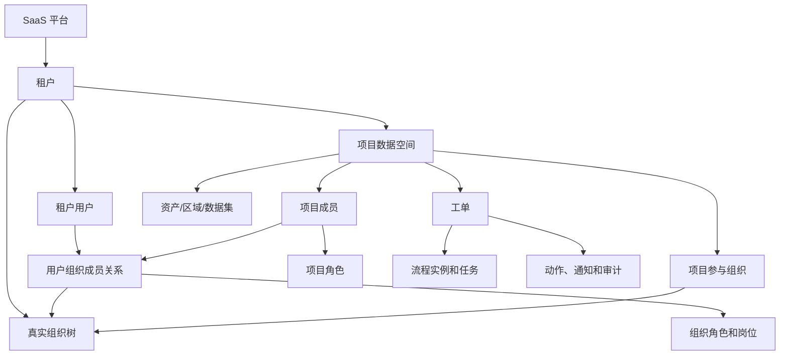

# SaaS 智慧城市权限与工单中心需求设计说明书

版本：V0.2  
当前基线：I19  
目标范围：权限中心、实体组织、项目数据权限、流程与工单中心、SaaS 隔离和治理

## 1. 文档目的

本文档整合当前 Demo 已实现能力与后续目标能力，作为产品需求、领域建模、接口设计、数据库迁移、自动化回归和人工验收的统一依据。

系统面向智慧城市 SaaS 场景。租户用于客户级数据隔离，组织表示现实中的政企主体与部门，项目表示跨组织的数据授权空间，角色决定用户能执行的动作，数据范围决定用户能访问的业务对象。

核心授权公式：

```text
ALLOW =
同一租户
∩ 有效用户与有效授权
∩ 功能权限
∩ 项目范围
∩ 组织范围
∩ 资源范围
∩ 对象关系
∩ 业务状态机
∩ 字段级策略
```

系统默认拒绝。活动组织和活动项目只用于界面上下文，后端必须根据资源自身的 `tenant_id`、`project_id` 和组织归属重新计算权限。

## 2. 产品定位和设计原则

### 2.1 产品定位

平台服务于住建、水务、市政、城运、园区和外部承建单位的协同业务，覆盖多租户、多组织、多项目、多类城市资产、跨单位工单流转和分级进度看板。

### 2.2 核心概念

| 概念 | 定义 | 不承担的职责 |
| --- | --- | --- |
| 租户 | 一个独立 SaaS 客户和数据安全边界 | 不表示组织部门 |
| 组织 | 真实存在的法人、委办局、公司、部门、班组或外部单位 | 不随项目重复创建 |
| 项目 | 跨组织的数据权限载体和业务协作空间 | 不进入真实组织树 |
| 角色 | 一组稳定的功能权限 | 不表示人员行政岗位 |
| 岗位 | 用户在真实组织中的职位或职责标签 | 不直接授予功能权限 |
| 数据范围 | 角色对组织、项目、资产、区域和对象的访问约束 | 不替代功能权限 |
| 工单 | 绑定租户和项目的业务处置单元 | 不自行决定授权 |
| 流程任务 | 工单当前节点的候选、认领和处理记录 | 不替代实时成员资格校验 |

### 2.3 设计原则

1. 租户隔离优先于任何角色权限。
2. 组织只维护真实关系，项目维护动态协作关系。
3. 一个用户可属于多个真实组织，也可参加多个项目。
4. 用户在不同组织和项目中可以拥有不同角色。
5. 岗位只用于身份表达和候选人解析，功能授权由角色完成。
6. 业务数据必须有稳定项目键，禁止根据界面选择推断授权。
7. 权限校验、状态变更、流程任务、动作时间线和通知应在同一事务中完成。
8. 历史数据不可因组织、成员或授权调整而丢失审计链。
9. 高权限授权应具备审批、有效期、复核和紧急授权能力。

## 3. 当前已完成能力

### 3.1 IAM 与认证

- 用户、组织树、角色、岗位和权限字典。
- 用户多组织成员关系；角色和岗位绑定在用户组织成员关系上。
- 角色权限配置和 `ALL`、`ORG`、`ORG_AND_CHILD`、`SELF`、`CUSTOM` 五类数据范围。
- 服务端登录会话、活动组织切换、活动组织失效校验。
- 用户、组织、角色、岗位、权限的管理 API 和管理页面。
- 用户启停、密码重置、成员关系替换和会话撤销。
- IAM 操作审计、搜索分页、批量导入导出。
- 角色、岗位、权限被引用时的安全删除约束。

### 3.2 工单中心

- 创建、提交、派单、竞争认领、处理、转派、复核驳回、复核通过和关闭。
- 中央状态机约束合法状态变化。
- 工单动作时间线和流程任务历史双时间线。
- 组织角色、岗位、指定组织和指定用户候选人解析。
- 服务端分页、组合筛选、排序、用户保存视图和批量派单/催办。
- 评论、催办、附件上传下载、基础安全扫描和站内通知。
- 按优先级配置响应时限和解决时限，支持 24x7 与工作日历。
- SLA 评估、响应超时、解决超时和通知。
- 我的任务、工作台统计、工单详情和权限控制的动作按钮。

### 3.3 工程质量

- FastAPI、SQLAlchemy、Alembic 和 SQLite Demo 运行基线。
- I01-I19 连续数据库迁移。
- 自动化单元、服务、API、页面、迁移、架构和发布冒烟回归。
- I19 基线共 135 项自动化测试通过，语句覆盖率 90.55%。

### 3.4 I19 SaaS 租户基线

- 租户主数据与默认 `DEMO` 演示租户。
- 用户、组织、角色、岗位、IAM 审计和认证会话具备租户归属。
- 用户名、组织编码、角色编码和岗位编码租户内唯一。
- 登录、请求上下文、用户档案、IAM 管理查询和流程候选人解析携带租户作用域。
- 跨租户同名用户、同编码组织、对象访问、活动组织切换和角色候选人隔离回归。

## 4. 目标总体架构



## 5. SaaS 租户需求

### 5.1 租户主数据

租户至少包含：租户编码、租户名称、状态、套餐、有效期、默认时区、默认语言和创建时间。

租户状态包括：`ACTIVE`、`SUSPENDED`、`EXPIRED`、`ARCHIVED`。非 `ACTIVE` 租户禁止建立新会话和新增业务数据，历史数据按治理策略只读保留。

### 5.2 租户数据隔离

- 所有租户级 IAM 和业务表必须包含 `tenant_id`。
- 用户名、组织编码、角色编码和岗位编码按租户内唯一。
- 全局 Permission 编码保持平台级稳定，不按租户复制。
- Repository 必须注入租户条件；生产 PostgreSQL 增加 RLS 二次保护。
- 缓存键、对象存储路径、后台任务、导入导出和审计事件必须携带租户。
- 平台管理员不默认获得租户业务数据读取权。

### 5.3 登录与会话

- 登录请求包含租户编码、用户名和密码；单租户 Demo 可配置默认租户编码。
- 会话保存 `tenant_id`、用户、活动组织，以及未来的活动项目。
- 活动组织必须属于当前用户且与会话租户一致。
- 租户、用户或成员关系停用时，会话即时失效。
- 同名用户可存在于不同租户，凭租户编码区分。

## 6. 实体组织需求

组织用于表达真实政企主体和内部部门。组织类型包括法人、委办局、公司、部门、班组、外部单位等。

组织保存真实组织编码、名称、类型、父组织、路径、排序、数据来源、生效时间、失效时间和状态。存在成员、项目引用或历史业务数据的组织不得物理删除。

用户可以拥有多个组织成员关系，其中一个可标记为主组织。用户的角色和岗位必须绑定到具体成员关系，禁止将组织角色直接绑定到裸用户。

## 7. 项目数据权限需求

### 7.1 项目定义

项目是业务数据授权空间，可表示建设项目、年度运维项目、专项行动、重大活动保障或区域运营单元。

项目状态包括：`DRAFT`、`ACTIVE`、`SUSPENDED`、`COMPLETED`、`ARCHIVED`。

### 7.2 项目关系

- 一个项目关联多个真实组织。
- 一个真实组织可参加多个项目。
- 项目成员引用用户组织成员关系，以明确其代表的组织身份。
- 一个用户可参加多个项目并拥有不同角色。
- 租户或城市级领导可通过项目范围查看多个项目，不要求逐项目成为成员。

### 7.3 项目资源范围

项目可关联城市资产、资产组、行政区、街道、网格、GIS 围栏、数据源和数据集。资产可以被多个项目引用，工单原则上只归属一个项目。

项目范围包括：全部项目、组织参与项目、本人负责项目、本人参加项目和自定义项目。

项目内部数据范围包括：项目全部、项目组织、项目组织及下级、本人、指定组织、资产范围、区域范围和数据集范围。

## 8. 角色、权限与数据策略

### 8.1 角色层级

| 上下文 | 典型角色 | 生效范围 |
| --- | --- | --- |
| 平台 | 平台管理员、平台审计员 | 平台能力，不默认读租户数据 |
| 租户 | 租户管理员、城市领导、租户审计员 | 当前租户 |
| 组织 | 部门负责人、组织用户管理员 | 指定真实组织 |
| 项目 | 项目负责人、调度员、处理人、复核人 | 指定项目 |

### 8.2 权限编码

系统权限编码保持稳定，至少包括：

```text
tenant:view / tenant:manage
system:org:* / system:user:* / system:role:* / system:position:*
project:view / project:manage / project:member:manage / project:resource:manage
workorder:view / workorder:create / workorder:dispatch / workorder:claim
workorder:handle / workorder:transfer:self / workorder:reassign:manage
workorder:comment / workorder:urge / workorder:attachment
workorder:review / workorder:close / workorder:sla:evaluate
dashboard:tenant:view / dashboard:project:view / dashboard:org:view
```

### 8.3 决策顺序

1. 校验租户、会话和用户状态。
2. 根据资源自身字段确定租户和项目，禁止只信任请求上下文。
3. 计算当前有效角色及功能权限。
4. 校验项目范围。
5. 校验项目内部组织范围。
6. 校验资产、区域、数据集和数据分级。
7. 校验创建人、候选人、处理人等对象关系。
8. 校验状态机和职责分离。
9. 应用字段级脱敏或禁止策略。

## 9. 工单中心需求

### 9.1 核心字段

目标工单包含：`tenant_id`、`project_id`、工单编号、类型、来源、优先级、归属组织、当前组织、当前处理人、创建人、资产、位置、描述、SLA 字段和状态。

流程实例、流程任务、候选人、动作、附件和通知均必须能够追溯到同一租户和项目。

### 9.2 状态流

```text
DRAFT
→ PENDING_DISPATCH
→ PENDING_CLAIM
→ PROCESSING
→ PENDING_REVIEW
→ COMPLETED
→ CLOSED
```

复核驳回从 `PENDING_REVIEW` 返回 `PROCESSING`。转派、评论、催办、附件和 SLA 事件不改变主状态。

`COMPLETED` 表示业务完成并计入项目进度，`CLOSED` 表示档案归档。

### 9.3 项目闭环规则

- 创建工单时必须选择有效项目。
- 发起组织必须是项目参与组织。
- 资产或区域必须在项目资源范围内。
- 工单提交后 `project_id` 不可修改。
- 派单目标组织必须参与同一项目。
- 流程候选规则必须同时包含项目、组织和角色/岗位上下文。
- 领取、处理、转派和复核时实时验证项目成员资格。
- 项目成员退出、到期或停用后立即失去新操作权限。
- 驳回时原处理人失效则进入重新派单，不直接生成无效任务。
- 项目归档后禁止创建和提交新工单，历史工单只读保留。

### 9.4 协作和治理

- 自助转派与管理员重新分配使用不同权限。
- 评论和附件在关闭后默认禁止新增，审计备注使用独立动作。
- 响应 SLA 与解决 SLA 使用独立状态字段。
- 附件使用对象存储、异步安全扫描和下载审计。
- 通知使用 Outbox、重试和多渠道扩展能力。
- 工单编号、创建接口和动作接口具备数据库并发控制与幂等键。

## 10. 看板与进度

公司领导查看租户授权范围内多个项目的总体进度；项目负责人查看单项目全部参与组织；项目部门负责人查看本组织；员工查看本人任务。

项目进度采用里程碑加权：

```text
里程碑进度 = 已完成工单权重 / 里程碑全部跟踪工单权重
项目进度 = Σ（里程碑进度 × 里程碑权重）
```

看板至少包含总体进度、里程碑、部门完成率、处理中、待派单、待认领、待复核、逾期和 SLA 违约。

汇总看板权限不自动授予敏感工单详情权限。

## 11. 审计与授权治理

- 所有授权变化记录租户、项目、组织、授权来源、操作者、前后值和有效期。
- 高权限角色支持双人审批、授权有效期、临时授权和紧急授权。
- 授权人不能授予自己没有的权限，不能扩大超出自身的数据范围。
- 用户离职、调岗、项目退出后即时失权。
- 提供“用户为什么能访问该数据”的授权链解释。
- 敏感数据查看、附件下载、导入导出和平台人员临时访问必须审计。

## 12. 非功能需求

- 生产数据库使用 PostgreSQL；SQLite 仅用于 Demo 和快速回归。
- 关键查询包含 `tenant_id` 和 `project_id` 索引。
- 使用乐观版本号或行锁控制竞争认领、重复派单和重复关闭。
- 创建工单和外部来源接入使用幂等键。
- 提供结构化日志、Trace、指标、告警、备份恢复和 RPO/RTO 演练。
- 安全基线包含 CSRF、登录限速、锁定、Secure Cookie、MFA/SSO 和密钥托管。

## 13. 迭代路线

### I19：租户与实体组织基线（已完成）

- 新增租户主数据。
- 用户、组织、角色、岗位、IAM 审计和认证会话增加租户归属。
- 用户名、组织编码、角色编码、岗位编码调整为租户内唯一。
- 登录支持租户编码，单租户 Demo 保持默认租户兼容。
- 请求上下文和用户档案返回租户信息。
- IAM Repository 对租户内查询进行隔离。
- 增加跨租户同名用户、同编码组织、会话和 IAM 列表隔离回归。

### I20：项目数据权限载体

- 项目、项目参与组织、项目成员、项目角色和项目资源范围。
- 项目范围解析和授权链解释基础。
- 项目 CRUD、成员维护和活动项目选择。

### I21：项目工单与流程闭环

- 工单、流程和任务绑定租户及项目。
- 项目内派单、候选人解析、实时资格校验和跨项目隔离。
- 历史工单迁移到租户默认运营项目。

### I22：智慧城市资源权限

- 资产组、行政区域、GIS 围栏、数据集和数据分级。
- 字段级脱敏、敏感详情权限和项目资源看板。

### I23：SaaS 授权治理与发布验收

- 授权审批、有效期、紧急授权、定期复核和职责分离。
- PostgreSQL RLS、幂等并发、监控审计和完整人工验收包。

## 14. 核心验收矩阵

1. 不同租户允许存在相同用户名和组织编码。
2. 租户 A 用户不能登录租户 B，也不能查询租户 B 的 IAM 数据。
3. 用户可以属于多个真实组织，切换组织后权限即时重算。
4. 用户可以参加多个项目，不同项目角色互不串用。
5. 公司领导可查看授权范围内多个项目汇总，但无明细权限时不能查看敏感工单。
6. 项目负责人只能查看本项目全部组织数据。
7. 项目部门负责人只能查看本项目、本组织及下级数据。
8. 普通成员只能查看本人创建、候选或处理的数据。
9. 非项目组织不能接收项目工单。
10. 非项目成员不能认领、处理、转派或复核项目工单。
11. 成员退出、角色撤销或授权到期后立即失权。
12. 修改活动项目不能绕过资源自身项目归属校验。
13. 项目归档后禁止新增业务，但历史数据和审计可读。
14. 并发认领只成功一次，重复请求不产生重复动作和通知。
15. 现有无项目 Demo 数据在迁移后仍可访问，原有主流程回归全部通过。

## 15. 当前版本边界

I19 适合产品演示和租户隔离规则验证，不应直接作为生产系统上线。完成 I20-I23 后仍需通过项目数据权限、生产认证安全、PostgreSQL 并发、对象存储、异步任务、监控告警和灾备门禁，方可进入真实试点。
